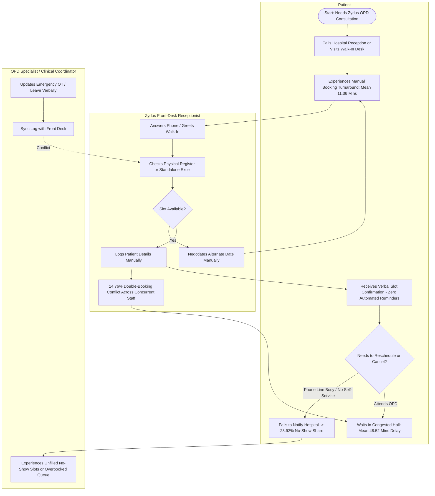
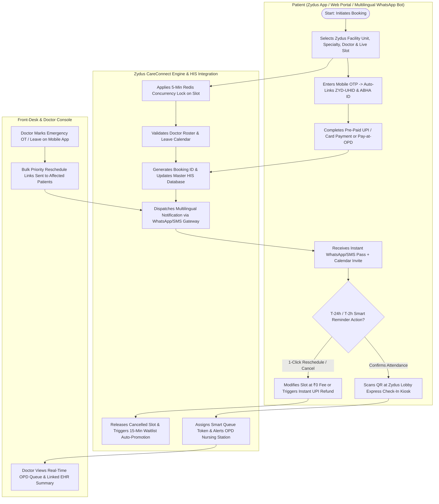

# Process Architecture: As-Is vs. To-Be Appointment Lifecycle (Zydus Hospitals Case Study)

## 1. Executive Summary of Process Transformation

> **Portfolio Scenario Note:** This process architecture models a hypothetical Business Analysis case study for **Zydus Hospitals** across 7 multispecialty facilities in **Gujarat (Ahmedabad & Bhuj), Maharashtra (Mumbai), Rajasthan (Jaipur), Delhi NCR (New Delhi), Karnataka (Bengaluru), and Tamil Nadu (Chennai)**. Metrics reflect the 5,000-row synthetic practice dataset.

| Process Dimension | As-Is State (Manual Baseline Cohort) | To-Be State (Omnichannel Cohort) | Cohort Variance |
| :--- | :--- | :--- | :--- |
| **Booking Channels** | Phone Call (60.40%), Walk-In Desk (39.60%) | Mobile App (28.88%), Web Portal (22.76%), WhatsApp Bot (22.40%), Walk-In (15.32%), Phone (10.64%) | **74.04% Digital Self-Service** |
| **Mean Booking Turnaround** | 11.36 minutes | 1.79 minutes | **-84.24% Relative Reduction** |
| **OPD Patient No-Show Share** | 23.92% (598 / 2,500) | 7.28% (182 / 2,500) | **-16.64 Percentage Points** |
| **Double-Booking Conflict Share** | 14.76% (369 / 2,500) | 0.00% (0 / 2,500; Redis 300s TTL Lock) | **100% Conflict Elimination** |
| **Cancelled Slot Re-Fill Rate** | 4.83% (18 / 373 refilled manually) | 78.17% (154 / 197 refilled via Waitlist Engine) | **+73.34 Percentage Points** |
| **Mean OPD Waiting Hall Time** | 48.52 minutes (Completed visits) | 14.25 minutes (Completed visits) | **-70.63% Relative Reduction** |

---

## 2. As-Is Process Map (Mermaid Flowchart)

---

## 3. To-Be Process Map (Mermaid Flowchart)

